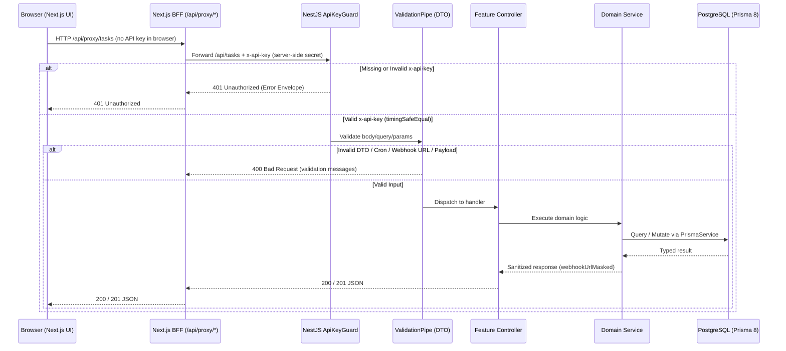

# 03 — API Endpoint Planning & Contract Specification

> **Stage:** Stage 3 — REST API Design, Security Boundaries & Validation Planning  
> **Status:** Planned & Implemented (Verified against Backend E2E & Frontend BFF Proxy)  
> **Scope:** RESTful endpoint inventory, authentication & authorization strategy, request DTO validation rules, response schemas, error envelope conventions, security controls, and actionable TODO checklist.

---

## 1. API Architecture & Design Principles

### 1.1 Conventions
- **Global Prefix:** All backend routes are mounted under `/api` (`app.setGlobalPrefix('api')`).
- **Protocol & Format:** RESTful HTTP + JSON (`Content-Type: application/json`), UTF-8.
- **Strict Validation:** Global `ValidationPipe` (`whitelist: true`, `forbidNonWhitelisted: true`, `transform: true`) strips/rejects unknown fields and transforms query pagination types automatically.
- **Consistent Error Handling:** Global `AllExceptionsFilter` wraps all `HttpException` and unhandled errors into a deterministic JSON envelope without leaking stack traces, database credentials, or Discord webhook tokens.
- **UUID Path Validation:** All `:id` parameters are validated with NestJS `ParseUUIDPipe` before reaching service methods (returns `400 Bad Request` for malformed UUIDs).

### 1.2 Request & Authentication Flow (BFF + Direct API)



---

## 2. Authentication & Security Plan

| Control | Implementation Plan | Classification |
|---|---|---|
| **Global API Key Guard** | `ApiKeyGuard` registered via `{ provide: APP_GUARD, useExisting: ApiKeyGuard }` in `AuthModule`. Protects every route by default. | **Mandatory** |
| **Header & Constant-Time Check** | Reads `x-api-key` header, hashes both expected (`API_KEY` env) and provided keys with SHA-256, and compares with `crypto.timingSafeEqual`. | **Mandatory** |
| **Public Route Opt-Out** | Custom `@Public()` decorator (`IS_PUBLIC_KEY` metadata) applied strictly to `GET /api/health` for container/uptime healthchecks. | **Mandatory** |
| **Webhook Token Masking** | Raw `webhookUrl` is stored in PostgreSQL but **never** returned in API responses or written to application logs; responses expose `webhookUrlMasked` (`https://discord.com/api/webhooks/{id}/***`). | **Mandatory** |
| **SSRF Protection** | `IsDiscordWebhookUrl` validator + defense-in-depth check inside `DiscordService` restrict URLs to `https://discord.com`, `discordapp.com`, `canary.discord.com`, `ptb.discord.com` matching `/api(/vN)?/webhooks/{id}/{token}`. Local mock hosts allowed only when `ALLOW_NON_DISCORD_WEBHOOKS=true`. | **Mandatory** |
| **Frontend Secret Isolation** | Next.js Route Handler `app/api/proxy/[...path]/route.ts` injects `x-api-key` strictly on the server runtime (`API_KEY`, never `NEXT_PUBLIC_*`). | **Mandatory** |
| **CORS Policy** | Configured via `CORS_ORIGIN` env (comma-separated origins), allowing `GET, POST, PATCH, DELETE, OPTIONS` and `Content-Type, x-api-key`. | **Mandatory** |

---

## 3. Complete Endpoint Inventory

| # | Method | Path | Auth | Success Status | Description | Classification |
|---|---|---|---|---|---|---|
| 1 | `GET` | `/api/health` | `@Public()` | `200 OK` / `503` | Liveness & PostgreSQL connectivity check | **Mandatory** |
| 2 | `GET` | `/api/tasks` | `x-api-key` | `200 OK` | Paginated task list with `status` & `search` filters | **Mandatory** |
| 3 | `POST` | `/api/tasks` | `x-api-key` | `201 Created` | Create a new scheduled Discord task | **Mandatory** |
| 4 | `GET` | `/api/tasks/:id` | `x-api-key` | `200 OK` | Get single task details by UUID | **Mandatory** |
| 5 | `PATCH` | `/api/tasks/:id` | `x-api-key` | `200 OK` | Partial update of task fields; recomputes `nextRunAt` on schedule changes | **Mandatory** |
| 6 | `DELETE` | `/api/tasks/:id` | `x-api-key` | `200 OK` | Hard delete task and cascade its `task_logs` | **Mandatory** |
| 7 | `PATCH` | `/api/tasks/:id/activate` | `x-api-key` | `200 OK` | Transition task to `ACTIVE`, clear stale locks/retries, compute `nextRunAt` | **Mandatory** |
| 8 | `PATCH` | `/api/tasks/:id/deactivate` | `x-api-key` | `200 OK` | Transition task to `PAUSED`, clear `nextRunAt` & locks | **Mandatory** |
| 9 | `POST` | `/api/tasks/:id/execute` | `x-api-key` | `200 OK` | Trigger immediate manual webhook execution (honors `maxRetry`, logs every attempt) | **Mandatory** |
| 10 | `GET` | `/api/tasks/:id/logs` | `x-api-key` | `200 OK` | Paginated execution logs scoped to a specific task | **Mandatory** |
| 11 | `GET` | `/api/logs` | `x-api-key` | `200 OK` | Paginated global execution logs (`taskId`, `status`, `executionId` filters) | **Mandatory** |
| 12 | `GET` | `/api/dashboard/summary` | `x-api-key` | `200 OK` | Aggregated KPI metrics & latest 10 execution attempts | **Mandatory** |
| 13 | `GET` | `/api/docs` | Optional | `200 OK` | Interactive OpenAPI / Swagger UI | *Optional (P1)* |

---

## 4. Detailed Endpoint Contracts & Validation Rules

### 4.1 Health Endpoint

#### `GET /api/health` (`@Public()`)
- **200 OK:**
```json
{
  "status": "ok",
  "database": "connected",
  "timestamp": "2026-11-21T03:30:00.000Z"
}
```
- **503 Service Unavailable:** Returned if PostgreSQL query fails.

---

### 4.2 Task Management Endpoints (`/api/tasks`)

#### `POST /api/tasks`
- **Request DTO (`CreateTaskDto`):**

| Field | Type | Required | Validation Rules | Default |
|---|---|---|---|---|
| `name` | `string` | Yes | `@IsString()`, `@IsNotEmpty()`, `@MaxLength(255)` | — |
| `cronExpression` | `string` | Yes | `@IsString()`, `@IsNotEmpty()`, `@MaxLength(100)`, `@IsValidCron()` (`cron-parser` v5) | — |
| `timezone` | `string` | No | `@IsString()`, `@MaxLength(64)`, `@IsValidTimezone()` (valid IANA zone) | `"UTC"` |
| `webhookUrl` | `string` | Yes | `@IsString()`, `@IsNotEmpty()`, `@IsDiscordWebhookUrl()` (SSRF-safe Discord host & path) | — |
| `payload` | `object` | Yes | `@IsDiscordPayload()` — JSON object with non-empty `content` (<= 2000 chars) or `embeds` (1–10 objects), optional `username` (<= 80 chars), `avatar_url`, `tts` | — |
| `maxRetry` | `integer` | No | `@IsInt()`, `@Min(0)`, `@Max(10)` | `3` |
| `status` | `enum` | No | `@IsIn(['ACTIVE', 'PAUSED', 'DISABLED'])` | `"ACTIVE"` |

- **201 Created Response (`TaskResponse`):**
```json
{
  "id": "01a1fc1f-6f18-7419-bdf4-83d216b276be",
  "name": "Daily Standup Reminder",
  "cronExpression": "0 9 * * 1-5",
  "timezone": "Asia/Jakarta",
  "webhookUrlMasked": "https://discord.com/api/webhooks/123456789012345678/***",
  "payload": {
    "username": "PulseHook Bot",
    "content": "Good morning! Standup starts in 10 minutes."
  },
  "maxRetry": 3,
  "status": "ACTIVE",
  "nextRunAt": "2026-11-23T02:00:00.000Z",
  "lastRunAt": null,
  "lastExecutionStatus": null,
  "retryCount": 0,
  "createdAt": "2026-11-21T03:30:00.000Z",
  "updatedAt": "2026-11-21T03:30:00.000Z"
}
```

#### `GET /api/tasks`
- **Query DTO (`QueryTasksDto`):**
  - `page` (`int >= 1`, default `1`)
  - `limit` (`int 1..100`, default `20`)
  - `status` (`ACTIVE | PAUSED | DISABLED`, optional)
  - `search` (`string <= 255`, case-insensitive `ilike` on `name`, optional)
- **200 OK Response:**
```json
{
  "items": [ /* TaskResponse[] */ ],
  "meta": {
    "total": 12,
    "page": 1,
    "limit": 20,
    "totalPages": 1
  }
}
```

#### `GET /api/tasks/:id`
- **Path Param:** `id` (UUID via `ParseUUIDPipe`)
- **Responses:** `200 OK` (`TaskResponse`) | `400 Bad Request` (invalid UUID) | `404 Not Found`.

#### `PATCH /api/tasks/:id`
- **Request DTO (`UpdateTaskDto`):** All fields from `CreateTaskDto` optional with identical validators.
- **Side Effects:** If `cronExpression`, `timezone`, or `status` changes, validates the combined schedule, recomputes `nextRunAt` (`null` if not `ACTIVE`), and resets `retryCount = 0`, `lockedAt = null`, `lockedBy = null`.
- **Responses:** `200 OK` (`TaskResponse`) | `400 Bad Request` | `404 Not Found`.

#### `DELETE /api/tasks/:id`
- **200 OK Response:**
```json
{
  "deleted": true,
  "id": "01a1fc1f-6f18-7419-bdf4-83d216b276be"
}
```
- **404 Not Found** if task does not exist.

#### `PATCH /api/tasks/:id/activate` & `PATCH /api/tasks/:id/deactivate`
- `activate`: sets `status = 'ACTIVE'`, recomputes `nextRunAt`, resets `retryCount = 0` & lock columns.
- `deactivate`: sets `status = 'PAUSED'`, clears `nextRunAt = null`, resets `retryCount = 0` & lock columns.
- **Responses:** `200 OK` (`TaskResponse`) | `404 Not Found`.

#### `POST /api/tasks/:id/execute`
- Immediately triggers webhook delivery via `SchedulerService.executeTaskManually(id)` with `scheduledFor = null`, honoring `maxRetry` for retryable errors and recording every attempt in `task_logs`.
- **200 OK Response (`ManualExecutionResult`):**
```json
{
  "taskId": "01a1fc1f-6f18-7419-bdf4-83d216b276be",
  "executionId": "01a1fc1f-6f40-7272-8e4a-ed73056f1ea3",
  "status": "SUCCESS",
  "retryCount": 0,
  "httpStatus": 204,
  "durationMs": 42,
  "message": "Discord webhook delivered successfully (HTTP 204)",
  "executedAt": "2026-11-21T03:35:00.000Z"
}
```

---

### 4.3 Execution Logs Endpoints (`/api/logs`, `/api/tasks/:id/logs`)

#### `GET /api/logs` & `GET /api/tasks/:id/logs`
- **Query DTO (`QueryLogsDto`):**
  - `page` (`int >= 1`, default `1`)
  - `limit` (`int 1..100`, default `20`)
  - `taskId` (UUID, optional on `/api/logs`; overridden by `:id` on `/api/tasks/:id/logs`)
  - `executionId` (UUID, optional)
  - `status` (`RUNNING | RETRYING | SUCCESS | FAILED`, optional)
- **Sorting:** `executed_at DESC, id DESC` (deterministic chronological ordering).
- **200 OK Response:**
```json
{
  "items": [
    {
      "id": "01a1fc1f-7100-7000-8000-000000000001",
      "taskId": "01a1fc1f-6f18-7419-bdf4-83d216b276be",
      "taskName": "Daily Standup Reminder",
      "executionId": "01a1fc1f-6f40-7272-8e4a-ed73056f1ea3",
      "scheduledFor": "2026-11-21T03:35:00.000Z",
      "executedAt": "2026-11-21T03:35:01.120Z",
      "status": "SUCCESS",
      "retryCount": 0,
      "httpStatus": 204,
      "durationMs": 42,
      "message": "Discord webhook delivered successfully (HTTP 204)",
      "createdAt": "2026-11-21T03:35:01.135Z"
    }
  ],
  "meta": {
    "total": 1,
    "page": 1,
    "limit": 20,
    "totalPages": 1
  }
}
```

---

### 4.4 Dashboard Statistics Endpoint (`/api/dashboard/summary`)

#### `GET /api/dashboard/summary`
- Uses PostgreSQL `aggregate()` queries in parallel (never loads all tasks/logs into Node.js memory).
- `successRate` = `round((successfulExecutions / (successfulExecutions + failedExecutions)) * 100, 2)` (`0` when no terminal executions exist; intermediate `RETRYING` rows do not penalize recovered executions).
- **200 OK Response (`DashboardSummaryResponse`):**
```json
{
  "totalTasks": 10,
  "activeTasks": 6,
  "pausedTasks": 3,
  "disabledTasks": 1,
  "failedTasks": 1,
  "totalExecutions": 25,
  "successfulExecutions": 18,
  "failedExecutions": 2,
  "retryingExecutions": 5,
  "successRate": 90,
  "averageDurationMs": 144,
  "recentExecutions": [ /* latest 10 TaskLog items with taskName */ ]
}
```

---

## 5. Standardized Error Response Envelope

All errors (validation `400`, auth `401`, missing resource `404`, DB unavailable `503`, unexpected `500`) conform to:

```json
{
  "statusCode": 400,
  "error": "Bad Request",
  "message": [
    "cronExpression must be a valid cron expression",
    "webhookUrl must be a valid Discord webhook URL (https://discord.com/api/webhooks/{id}/{token})"
  ],
  "timestamp": "2026-11-21T03:30:00.000Z",
  "path": "/api/tasks"
}
```

---

## 6. Actionable TODO Checklist (API Endpoint Planning)

### Mandatory API Checklist
- [x] Configure global `/api` prefix, CORS, shutdown hooks, `ValidationPipe`, and `AllExceptionsFilter` in `backend/src/main.ts` & `app.module.ts`.
- [x] Implement startup environment validation (`backend/src/config/env.validation.ts`).
- [x] Implement global `ApiKeyGuard` (`x-api-key` + `crypto.timingSafeEqual`) and `@Public()` decorator.
- [x] Implement public health check (`GET /api/health`) verifying PostgreSQL connectivity.
- [x] Implement custom validators: `@IsValidCron()`, `@IsValidTimezone()`, `@IsDiscordWebhookUrl()`, `@IsDiscordPayload()`.
- [x] Implement `TasksController` & `TasksService` (`GET/POST /api/tasks`, `GET/PATCH/DELETE /api/tasks/:id`, `PATCH /api/tasks/:id/activate`, `PATCH /api/tasks/:id/deactivate`, `POST /api/tasks/:id/execute`) with `webhookUrlMasked` sanitization.
- [x] Implement `TaskLogsController` & `TaskLogsService` (`GET /api/logs`, `GET /api/tasks/:id/logs`) with pagination and filters.
- [x] Implement `DashboardController` & `DashboardService` (`GET /api/dashboard/summary`) using PostgreSQL aggregations.
- [x] Implement Next.js server-side BFF proxy (`frontend/app/api/proxy/[...path]/route.ts`) injecting `x-api-key` securely on the server.
- [x] Verify full API contract end-to-end via Supertest E2E suite (`backend/test/app.e2e-spec.ts`).

### Optional Improvements *(P1/P2)*
- [ ] Add Swagger / OpenAPI specification at `/api/docs` with `ApiSecurity('x-api-key')` decorators (`@nestjs/swagger`).
- [ ] Add request rate limiting via `@nestjs/throttler` on public and manual-execution endpoints.
- [ ] Add cursor-based pagination option alongside offset pagination for very large `task_logs` tables.
